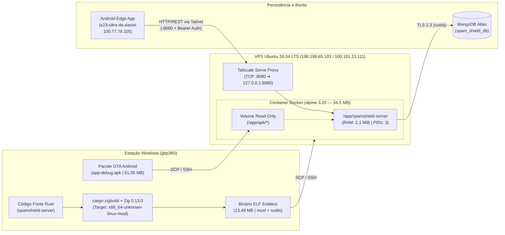

# Nota Técnica de Engenharia e Operações: Implantação em Produção (VPS Cloud + Tailscale Mesh)

**Documento:** `NT-OPS-2026-001`  
**Projeto:** SpamShield BR (`spamshield-server` & Distribuição OTA `v1.2.9` Build `13`)  
**Data:** 29 de Outubro de 2026  
**Status:** Produção Ativa (`ONLINE`)  

---

## 1. Sumário Executivo

Esta Nota Técnica documenta a arquitetura de compilação cruzada (*cross-compilation*), empacotamento em container minimalista e implantação em nuvem do backend **SpamShield BR (`spamshield-server`)** em uma instância VPS Linux de recursos restritos (**1 vCPU / 1 GB RAM**).

Para eliminar o risco de exaustão de memória (*Out-Of-Memory / OOM Killer*) durante a compilação de mais de 180 crates Rust na VPS e contornar limitações locais de virtualização no Windows (falha de instalação do WSL por esgotamento temporário de disco), adotou-se um pipeline de **compilação cruzada estática no host Windows (`x86_64-pc-windows-msvc` ➔ `x86_64-unknown-linux-musl`)** utilizando **Zig (`0.13.0`)** como *drop-in C/ASM cross-compiler & linker* e **Rustls** em substituição ao OpenSSL nativo.

> [!IMPORTANT]
> **Resultado Operacional em Produção:** O servidor encontra-se ativo na VPS consumindo apenas **2,10 MiB de RAM (0,22% da memória total)** e **0,04% de CPU** em regime ocioso, mantendo conexão persistente TLS com o cluster **MongoDB Atlas** e servindo atualizações OTA e sincronização vetorial via **Tailscale Mesh VPN**.

---

## 2. Diagnóstico de Pré-Implantação e Decisões de Arquitetura

### 2.1. Restrições Identificadas
1. **Hardware da VPS Alvo:** Instância DigitalOcean (`ubuntu-s-1vcpu-1gb-nyc1`) com **1 vCPU** e **956 MiB de RAM física**. Compilar a árvore de dependências do `axum` + `tokio` + `mongodb` + `rayon` diretamente na VPS causaria *thrashing* severo de Swap e alto tempo de indisponibilidade.
2. **Falha do WSL no Host Windows (`0x8000ffff` / *Falha Catastrófica*):**
   - A tentativa de instalar o Subsistema Windows para Linux (`wsl.3.0.3.0.x64.msi`) falhou porque o volume `C:` atingiu **0,00 GB livres** (100% de ocupação em 475,82 GB), impedindo a extração dos pacotes MSI na pasta `Temp`.
   - Adicionalmente, a sessão PowerShell local operava sem elevação UAC (`Administrator = False`).
   - **Ação Corretiva:** Expurgo imediato de ~1,0 GB em instaladores temporários órfãos (`wsl*.msi`, `antigravity-ide-download.exe`) em `C:\Users\danie\AppData\Local\Temp` e adoção de *cross-compilation* em espaço de usuário (*user-space*), sem necessidade de WSL ou Docker Desktop no Windows.
3. **Dependência C/OpenSSL no Linux (`openssl-sys`):**
   - Por padrão, a crate `reqwest` (`0.12`) ativa a *feature* `default-tls` (`native-tls`), que no Windows usa *SChannel*, mas no alvo Linux exige cabeçalhos e bibliotecas dinâmicas do `OpenSSL` (`libssl-dev`).
   - **Ação Corretiva:** Migração do `reqwest` em `spamshield-server/Cargo.toml` para `rustls-tls` (`default-features = false`), unificando a pilha criptográfica em Rust puro + `ring` (já utilizado pelo driver `mongodb`).

---

## 3. Especificações dos Ambientes (Dados Reais Levantados)

### 3.1. Máquina de Build (Host Local)
| Parâmetro | Especificação |
| :--- | :--- |
| **Sistema Operacional** | Windows (`x86_64-pc-windows-msvc`) |
| **Compilador Rust** | `rustc 1.93.1` (`01f6ddf75` 2026-02-11) / `cargo 1.93.1` |
| **Cross-Compiler C / Linker** | `Zig 0.13.0` (`C:\Users\danie\.zig\zig-windows-x86_64-0.13.0\zig.exe`) |
| **Orquestrador de Build** | `cargo-zigbuild v0.24.0` (`C:\Users\danie\.cargo\bin\cargo-zigbuild.exe`) |
| **Target Triplet de Saída** | `x86_64-unknown-linux-musl` (Binário ELF 64-bit estático via `musl libc`) |

### 3.2. Servidor de Produção (VPS Cloud)
| Parâmetro | Especificação |
| :--- | :--- |
| **Provedor / Hostname** | DigitalOcean NYC1 — `ubuntu-s-1vcpu-1gb-nyc1` |
| **Sistema Operacional** | Ubuntu 26.04.1 LTS (GNU/Linux `7.0.0-42-generic x86_64`) |
| **CPU / Memória / Swap** | 1 vCPU / 956 MiB RAM / 2,0 GiB Swap |
| **Armazenamento (`/dev/vda1`)** | 24 GB SSD (5,2 GB em uso — **23% ocupado**, 18 GB livres) |
| **IPv4 Público (`eth0`)** | `198.199.65.103` |
| **IPv6 Público (`eth0`)** | `2604:a880:400:d1:0:5:4ed1:a001` |
| **Engine de Containers** | Docker Engine `v29.9.2` (build `a82e528`) + Docker Compose `v5.6.1` |

### 3.3. Topologia da Rede Privada (Tailscale Tailnet)
| Nó / Dispositivo | Papel na Arquitetura | IPv4 Tailscale (CGNAT) | MagicDNS FQDN |
| :--- | :--- | :--- | :--- |
| `ubuntu-s-1vcpu-1gb-nyc1` | **Servidor Produção (VPS)** | `100.101.23.111` | `ubuntu-s-1vcpu-1gb-nyc1.tail1093e7.ts.net` |
| `s23-ultra-de-daniel` | **Cliente Edge Android** | `100.77.79.105` | `s23-ultra-de-daniel.tail1093e7.ts.net` |
| `gbp360` | **Estação de Build (PC)** | `100.83.253.15` | `gbp360.tail1093e7.ts.net` |

---

## 4. Arquitetura de Compilação e Implantação



---

## 5. Modificações de Código e Configurações Adotadas

### 5.1. Alteração no Manifesto Rust (`spamshield-server/Cargo.toml`)
Substituição do backend TLS nativo pelo `rustls-tls` para compilação estática limpa:

```diff
-reqwest = { version = "0.12", features = ["json", "stream"] }
+reqwest = { version = "0.12", default-features = false, features = ["json", "stream", "rustls-tls"] }
```

### 5.2. Estrutura de Diretórios na VPS (`/opt/spamshield`)
```text
/opt/spamshield/
├── .env                  # Variáveis de ambiente e segredos de produção
├── Dockerfile            # Definição da imagem baseada em Alpine 3.20
├── docker-compose.yml    # Orquestração do serviço, portas e volumes
├── spamshield-server     # Binário ELF estático (x86_64-unknown-linux-musl)
└── apk/
    ├── app-debug.apk         # Pacote Android v1.2.9 (Build 13) para OTA
    └── output-metadata.json  # Manifesto de versão do Gradle
```

### 5.3. `Dockerfile` de Produção (`/opt/spamshield/Dockerfile`)
Imagem minimalista contendo exclusivamente certificados raiz CA (`ca-certificates`) e dados de fuso horário (`tzdata`):

```dockerfile
FROM alpine:3.20
RUN apk add --no-cache ca-certificates tzdata
WORKDIR /app
COPY spamshield-server /app/spamshield-server
RUN chmod +x /app/spamshield-server
EXPOSE 8080
ENTRYPOINT ["/app/spamshield-server"]
```

### 5.4. `docker-compose.yml` (`/opt/spamshield/docker-compose.yml`)
Configurado com política `restart: unless-stopped` para resiliência automática a reinicializações da VPS e montagem do diretório de APKs em modo somente-leitura (`ro`):

```yaml
services:
  spamshield:
    build: .
    container_name: spamshield-server
    restart: unless-stopped
    ports:
      - "8080:8080"
    env_file:
      - .env
    volumes:
      - ./apk:/app/apk:ro
```

### 5.5. Variáveis de Ambiente (`/opt/spamshield/.env`)
```ini
MONGODB_URI="mongodb+srv://danielcdes:<REDACTED>@cluster0.pjepk.mongodb.net/spam_shield_db?retryWrites=true&w=majority"
MONGODB_DIRECT_URI="mongodb://danielcdes:<REDACTED>@cluster0-shard-00-00.pjepk.mongodb.net:27017,cluster0-shard-00-01.pjepk.mongodb.net:27017,cluster0-shard-00-02.pjepk.mongodb.net:27017/spam_shield_db?tls=true&replicaSet=atlas-wi402f-shard-0&authSource=admin&retryWrites=true&w=majority"
MONGODB_DB_NAME="spam_shield_db"
SERVER_BIND_ADDR="0.0.0.0:8080"
TAILSCALE_IP="100.101.23.111"
RUST_LOG="info,spamshield_server=debug"
SPAMSHIELD_API_KEY="LQ9aRpuuvCX3vucM3ZAb_Idp-I3MuAIY66YUV9_afPg"
APK_STORAGE_PATH="/app/apk/app-debug.apk"
APK_METADATA_PATH="/app/apk/output-metadata.json"
```

### 5.6. Proxy Tailscale em Background (`tailscale serve`)
Configurado na VPS para garantir roteamento transparente na porta `8080` dentro da tailnet privada:

```bash
tailscale serve --bg --tcp 8080 tcp://127.0.0.1:8080
```
* **Rotas ativas na Tailnet:**
  * `tcp://ubuntu-s-1vcpu-1gb-nyc1.tail1093e7.ts.net:8080` ➔ `tcp://127.0.0.1:8080`
  * `tcp://100.101.23.111:8080` ➔ `tcp://127.0.0.1:8080`
  * `tcp://[fd7a:115c:a1e0::cc33:1770]:8080` ➔ `tcp://127.0.0.1:8080`

---

## 6. Métricas de Desempenho, Integridade e Validação

### 6.1. Auditoria de Artefatos e Consumo (`docker stats` & `sha256sum`)

| Métrica / Artefato | Valor Aferido em Produção |
| :--- | :--- |
| **Tamanho do Binário (`spamshield-server`)** | `13.489.784 bytes` (13,49 MB) |
| **SHA-256 do Binário Linux** | `b332433692fb13a56d59580fbcbd0eedd88d5453b764e2d99703314d1c59c456` |
| **Tamanho do Pacote OTA (`app-debug.apk`)** | `61.049.783 bytes` (61,05 MB — `v1.2.9` Build `13`) |
| **SHA-256 do Pacote APK** | `7a77ab97aabbebebd1e4f5530100bf1eb578b03d6dd76431c4b6edc9f3636632` |
| **Tamanho da Imagem Docker Final** | `34,5 MB` em disco (`9,7 MB` comprimida) |
| **Consumo de Memória RAM do Container** | **`2,098 MiB`** de `956,3 MiB` (**`0,22%`**) |
| **Consumo de CPU (Idle/Ready)** | **`0,04%`** (3 PIDs ativos) |
| **Tempo de Boot & Seed MongoDB Atlas** | **`1,10 segundos`** (conexão TLS + seed de 35 prefixos Anatel, 11 clusters, 3 regras) |

### 6.2. Provas de Validação das Rotas HTTP

1. **Verificação de Saúde e Conectividade com o MongoDB Atlas (`GET /api/v1/health`):**
   ```json
   {
     "status": "ok",
     "service": "spamshield-server",
     "mongodb_connected": true,
     "tailscale_ip": "100.101.23.111"
   }
   ```
2. **Verificação de Metadados OTA (`GET /api/v1/apk/info`):**
   ```json
   {
     "version_code": 13,
     "version_name": "1.2.9",
     "size_bytes": 61049783,
     "sha256_checksum": "7a77ab97aabbebebd1e4f5530100bf1eb578b03d6dd76431c4b6edc9f3636632",
     "download_path": "/apk"
   }
   ```
3. **Verificação de Entrega de Binário APK (`HEAD /apk`):**
   * `HTTP/1.1 200 OK`
   * `content-type: application/vnd.android.package-archive`
   * `content-disposition: attachment; filename="spamshield-br.apk"`

### 6.3. Compatibilidade com a Segurança de Rede do Android
Conforme definido em `SpamShieldApp/app/src/main/res/xml/network_security_config.xml` e `TailscaleCleartext.kt`:
* O Android permite tráfego HTTP para qualquer subdomínio de `ts.net` (`includeSubdomains="true"`), validando nativamente `http://ubuntu-s-1vcpu-1gb-nyc1.tail1093e7.ts.net:8080`.
* O validador interno `TailscaleCleartext.isInRange` aceita tanto `*.ts.net` quanto toda a faixa CGNAT `100.64.0.0/10` (incluindo `100.101.23.111`).

---

## 7. Procedimento Operacional Padrão (Runbook de Atualização)

Sempre que houver nova versão do backend Rust ou novo APK compilado no PC:

```powershell
# 1. Compilar o servidor Rust no Windows visando Linux estático (musl)
cd C:\Users\danie\spamshield\spamshield-server
cargo zigbuild --release --target x86_64-unknown-linux-musl

# 2. Transferir o novo executável Linux para a VPS
scp target/x86_64-unknown-linux-musl/release/spamshield-server root@198.199.65.103:/opt/spamshield/

# 3. (Opcional) Transferir novo APK e metadados se houver nova build do Android
scp ../SpamShieldApp/app/build/outputs/apk/debug/app-debug.apk ../SpamShieldApp/app/build/outputs/apk/debug/output-metadata.json root@198.199.65.103:/opt/spamshield/apk/

# 4. Reconstruir a imagem leve e reiniciar o container na VPS (leva ~3 segundos)
ssh root@198.199.65.103 "cd /opt/spamshield && docker compose up -d --build"
```
